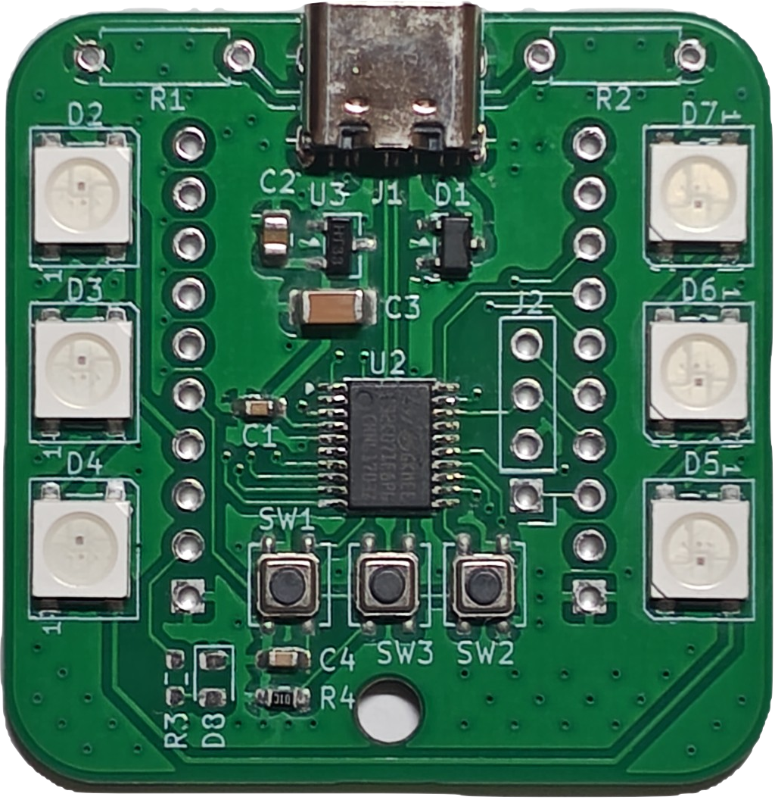
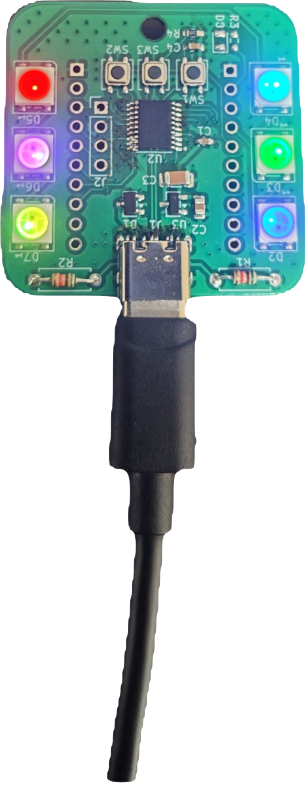
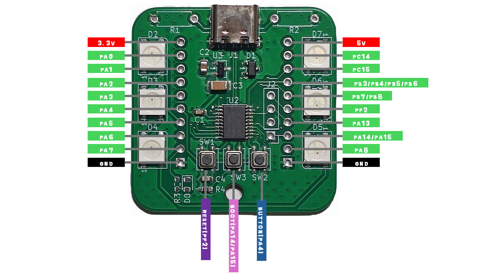
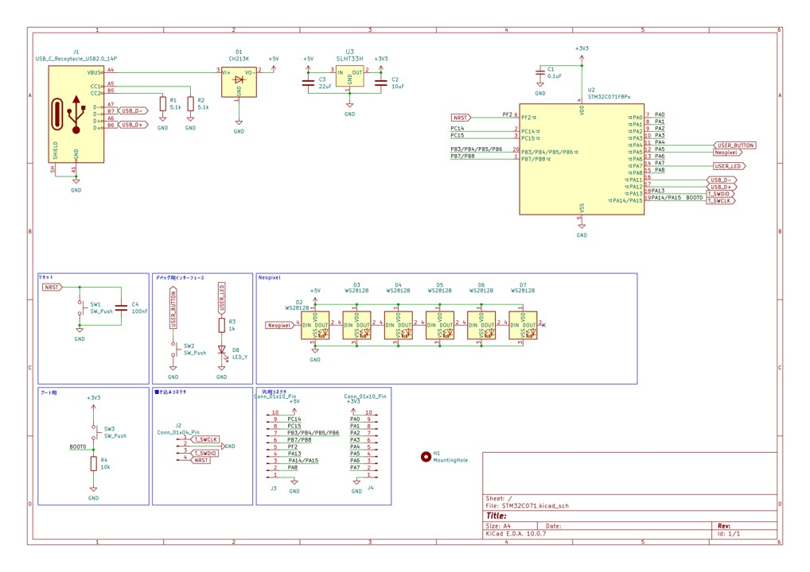

# 光る! マイコン搭載基板キーホルダー

マイコンとフルカラーLEDを搭載した、キーホルダーサイズのマイコンボードです。
USBケーブルを挿すだけでカラフルに光り、ボタンで発光パターンや色を変えられます。
STM32C071を搭載しているので、自分でプログラムを書き込んで好きなように遊ぶこともできます。

## 目次
- [特徴](#特徴)
- [仕様](#仕様)
- [使い方](#使い方)
- [各部説明](#各部説明)
- [注意事項](#注意事項)
- [おまけ機能](#おまけ機能)
- [改造](#改造)
- [マイコンボードとして使う](#マイコンボードとして使う)
- [回路図](#回路図)

## 特徴
1. **USBで光る**：USBケーブルを挿すとフルカラーLEDがレインボーに発光します。
2. **ボタンで変えられる**：ボタンを押すと発光パターンが変わり(全8パターン)、長押しで発光色が切り替わります。
3. **マイコンとして使える**：STM32C071を搭載。STM32の開発環境でプログラムでき、USB DFUで書き込めます(専用の書き込み器は不要です)。

## 仕様
| 項目 | 内容 |
| --- | --- |
| マイコン | STM32C071F8P6 |
| LED | フルカラーLED |
| 電源 | USB Type-C(5V) |
| 書き込み方式 | USB DFU |
| ボタン | BUTTON / BOOT / RESET の3つ |
| その他 | USB対応 |

## 使い方
1. 基板に金属が触れていないことを確認します(→[注意事項](#注意事項))。
2. USBケーブルを挿します。
3. LEDがカラフルに発光します。

### 発光パターン
BUTTON(基板上でSW2と書かれているボタン)を**単押し**すると、次のパターンに切り替わります。

1. レインボー
2. チェス
3. ナイトライダー
4. ランダム
5. イルミネーション
6. 単色
7. 点滅
8. じんわり点滅

8番目の次は、1番目に戻ります。
**長押し**すると発光色が切り替わります。

## 各部説明

### ボタン
| 名称 | 基板表記 | ピン | 役割 |
| --- | --- | --- | --- |
| BUTTON | SW2 | PA4 | プログラム用ボタン。初期状態では単押しで発光パターン変更、長押しで発光色変更。 |
| BOOT | SW3 | PA14/PA15 | 書き込み時に使用。押しながら電源ONまたはRESETで書き込みモードに入る。 |
| RESET | SW1 | PF2 | リセットボタン。押すとプログラムが最初から実行される。 |

### ピン配置
基板の両端に並ぶスルーホールから、各ピンを引き出せます。
基板の向きは上記の「各部説明」の図を基準にしています。

| 左列(上→下) | 右列(上→下) |
| --- | --- |
| 3.3V | 5V |
| PA0 | PC14 |
| PA1 | PC15 |
| PA2 | PB3 / PB4 / PB5 / PB6 |
| PA3 | PB7 / PB8 |
| PA4 | PF2 |
| PA5 | PA13 |
| PA6 | PA14 / PA15 |
| PA7 | PA8 |
| GND | GND |

> PA4(BUTTON)、PF2(RESET)、PA14/PA15(BOOT)は基板上のボタンとも接続されています。外部回路をつなぐ際は、ボタン操作と干渉しないよう注意してください。

## 注意事項
- **ショートに注意してください。** 保護素子は内蔵していますが、部品がむき出しのため、念のため金属類が接触していないことを確認してから電源を入れてください。
- **はんだ不良の可能性があります。** すべての部品を手作業で実装しているため、不良が含まれる場合があります。販売時にはキーホルダーとしての機能(ファームウェアの書き込み、LEDの発光、各ボタンの動作)のみ確認しており、それ以外の機能は未確認です。はんだ不良などがあった場合は、お手数ですが購入者様ご自身での修正をお願いします。
- **USB Type-Cは片面のみ通信できます。** コストの都合上、USBの通信は片面のみ対応です。書き込みやUSB CDCがうまくいかない場合は、ケーブルの挿す向きを変えてください。

## おまけ機能
### USB CDC(仮想シリアルポート)
USBで仮想シリアルポートを開いています。シリアルモニタが使える端末と接続すると、マイコンとコマンドをやり取りできます。
接続して`help`と送信すると、コマンド一覧が返ってきます。

## 改造
### C to Cケーブルでの給電
そのままではA to Cケーブルでのみ給電できます。
基板上部の未実装エリアに5.1kΩの抵抗を2つ実装すると、C to Cケーブルでも給電できるようになります。

## マイコンボードとして使う
このボードにはSTM32C071F8P6が載っています。STM32に対応した開発環境を使えば、好きなプログラムを書き込めます。

### 書き込み方法(USB DFU)
1. BOOTボタンを押しながら、USBケーブルを挿す(またはRESETボタンを押す)と、書き込みモードに入ります。
2. STM32CubeProgrammerを起動し、接続方式でUSBを選びます。
3. コンパイルしたバイナリを書き込みます。

書き込みにはSTM32CubeProgrammerの使用を推奨します。うまく認識されない場合は、USBの向きを変えてみてください。

### サンプルプログラム
リポジトリのsample_program内に初期ファームウェアのプロジェクトが入っています。
参考にするほか初期ファームに戻したくなった時などにご活用ください。

## 回路図
